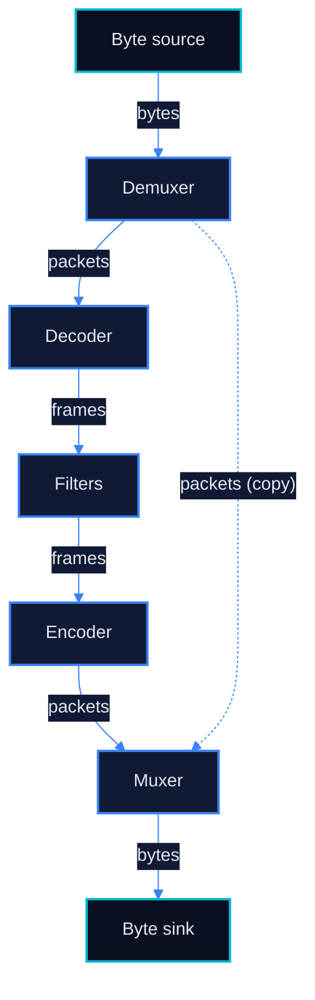
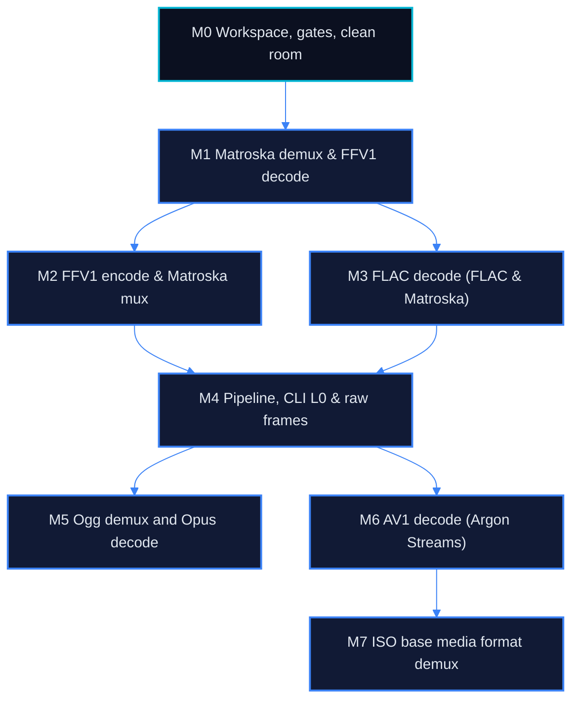

<!--
SPDX-FileCopyrightText: 2026 Lusoris <lusoris@pm.me>
SPDX-License-Identifier: EUPL-1.2
-->
<!-- markdownlint-disable MD013 MD033 MD041 -->

<div align="center">

  

  <!-- README-STANDARD badge block: one group, fixed order -->
  <!-- 1 release/version -->
  [](docs/plan/milestones.md)
  <!-- 2 CI/build -->
  [](https://github.com/vidiko/alveus/actions/workflows/ci.yml)
  [](https://github.com/vidiko/alveus/actions/workflows/reuse.yml)
  [](https://github.com/vidiko/alveus/actions/workflows/pages.yml)
  <!-- 3 security/scorecard -->
  [](SECURITY.md)
  [](https://coderabbit.ai)
  [](.github/rulesets/main.json)
  <!-- 4 standards -->
  [](AGENTS.md)
  [](CLEANROOM.md)
  [](CONTRIBUTING.md)
  <!-- 5 licence -->
  [](LICENSE)
  <!-- 6 support -->
  [](https://github.com/sponsors/lusoris)
  [](https://ko-fi.com/lusoris)

  **Clean-room media framework in Rust, written from public specifications.**

  *Planning stage: no framework code exists yet; milestone M0 sets up the
  workspace and gates, and M1 starts Matroska demuxing with FFV1 decoding.*

</div>

alveus is a planned media framework in Rust: containers, codecs, filters and
a command-line tool, written clean-room from public specifications
([CLEANROOM.md](CLEANROOM.md)). **Status: planning.** There is no framework
code yet. The plan is in [docs/plan/](docs/plan/README.md). Milestone M0 sets
up the workspace and the gates, and the first media milestone, M1, is Matroska
demuxing with FFV1 decoding ([milestones](docs/plan/milestones.md)).

*alveus* (written in lower case: alveus) is a Latin noun meaning a hollow or
cavity, and from that a trough, the hull of a ship, and the bed or channel of
a river — a river-channel sense that fits a framework that streams flow
through. It derives from Latin *alvus*, "belly", and English keeps the word as
a rare legal term for a river's bed or channel (source:
[Wiktionary, "alveus"](https://en.wiktionary.org/wiki/alveus)). Pronunciation
is **AL-weh-us** (with the last vowel as in English *put*; IPA [ˈaɫ.we.ʊs]) in
Classical Latin and **AL-vee-us** (IPA /ˈæl.vi.əs/) in English.

**[📖 Documentation](https://vidiko.github.io/alveus/)** · [Documentation source](docs/)

---

## 🎯 Why alveus

alveus sets out to build a media framework around explicit provenance, modular
crates and verifiable conformance ([docs/plan/README.md](docs/plan/README.md)).

| Aspect | How alveus handles it |
| :--- | :--- |
| Clean-room provenance | Contributors work from public specifications and from black-box measurements that a separate spec writer records, with an attestation on every pull request ([CLEANROOM.md](CLEANROOM.md)). |
| One crate per component | The planned Cargo workspace gives each container, codec and shared concern its own `alveus-<name>` crate so callers link only what they need ([docs/plan/architecture.md](docs/plan/architecture.md)). |
| Verifiable exit criteria | Media milestones close on an exact oracle (bit-exact frames, a conformance stream set or a stored checksum) and on fuzz targets that run for one CPU hour without a crash or hang ([docs/plan/milestones.md](docs/plan/milestones.md)). |
| High-integrity Rust | All planned code follows the HISS-21 rules: no recursion, bounded loops, explicit I/O deadlines, no allocation in hot loops, typed errors, and `unsafe` only in SIMD modules and the C interface, each block with a `// SAFETY:` proof ([AGENTS.md](AGENTS.md), [docs/plan/architecture.md](docs/plan/architecture.md)). |
| Licensing and REUSE | The repository is licensed under EUPL-1.2 ([LICENSE](LICENSE)), with per-file copyright and licence metadata checked by `reuse lint` ([REUSE.toml](REUSE.toml)). |

## 🚀 Get started

There is nothing to install yet because alveus is in the planning stage and has
no framework crates ([docs/plan/README.md](docs/plan/README.md)). To explore
the plan and verify the repository locally:

1. Read the [milestone ladder](docs/plan/milestones.md) and the
   [scope matrix](docs/plan/scope-matrix.md) to see what is planned and in
   which order.
2. Clone the repository and run the repository gate ([Makefile](Makefile)):

   ```bash
   git clone https://github.com/vidiko/alveus.git
   cd alveus
   make verify-all
   ```

## 🧩 At a glance

A planned conversion runs through five stages between a byte source and a byte
sink, or copies packets directly from demuxer to muxer
([docs/plan/architecture.md](docs/plan/architecture.md)).



See [docs/plan/architecture.md](docs/plan/architecture.md) for the planned
crate table and trait interfaces.

## 📚 Guides and reference

| Page | What it answers |
| :--- | :--- |
| [Documentation site](https://vidiko.github.io/alveus/) | Published overview, project plan and architectural decision records ([mkdocs.yml](mkdocs.yml)). |
| [docs/plan/README.md](docs/plan/README.md) | How the project plan is organised and which plan pages are still to be written. |
| [docs/plan/milestones.md](docs/plan/milestones.md) | What is built in which order from M0 to M7, and the exit criteria that gate each milestone. |
| [docs/plan/scope-matrix.md](docs/plan/scope-matrix.md) | Which containers, codecs, filters, protocols and hardware APIs are planned, from which specification and at which tier. |
| [docs/plan/architecture.md](docs/plan/architecture.md) | How the Cargo workspace is split into crates, the traits between stages, and the HISS rules every crate follows. |
| [docs/adr/README.md](docs/adr/README.md) | Index of append-only Architectural Decision Records covering the first vertical slice, CLI observation and normative reference code. |
| [CLEANROOM.md](CLEANROOM.md) | Allowed and forbidden inputs, the spec-writer and implementer role split, pull-request attestation and contamination handling. |
| [CONTRIBUTING.md](CONTRIBUTING.md) | High-Integrity Systems Standard (HISS) rules, 3D testing discipline, Conventional Commits and local verification. |
| [SECURITY.md](SECURITY.md) | Supported versions and how to report a vulnerability privately. |

## 🤝 Contribute

1. Read [CLEANROOM.md](CLEANROOM.md). It decides what you may read before you
   write anything.
2. Read [CONTRIBUTING.md](CONTRIBUTING.md) for the repository standard, commit
   format and test discipline.
3. Run the repository gate before opening a pull request:

   ```bash
   make verify-all
   ```

4. Fill in the clean-room attestation in the pull request template.

## 💖 Support

- **Security vulnerabilities**: report privately under
  [SECURITY.md](SECURITY.md) rather than opening a public issue.
- **Questions and bugs**: open an issue on
  [GitHub Issues](https://github.com/vidiko/alveus/issues).
- **Sponsorship**: support the project in any amount through
  [GitHub Sponsors](https://github.com/sponsors/lusoris) or
  [Ko-fi](https://ko-fi.com/lusoris); no support contract or issue priority is
  sold.

## 📈 Roadmap and releases

The milestone ladder builds one vertical slice at a time
([docs/plan/milestones.md](docs/plan/milestones.md)):



- Milestone scope, test material and exit criteria:
  [docs/plan/milestones.md](docs/plan/milestones.md).
- Issue tracking by milestone:
  [GitHub milestones](https://github.com/vidiko/alveus/milestones).
- No releases yet.

## Upstream and licence

alveus has no upstream code base: it is written clean-room from public
specifications under [CLEANROOM.md](CLEANROOM.md). For milestones M1 to M7
the [scope matrix](docs/plan/scope-matrix.md) names RFC 8794 (EBML), RFC 9559
(Matroska), RFC 9043 (FFV1), RFC 9639 (FLAC), RFC 3533 (Ogg), RFC 6716 (Opus),
the AOMedia AV1 Bitstream and Decoding Process Specification, and ISO/IEC
14496-12 (ISO base media file format); it lists every planned specification.

alveus is licensed under the European Union Public Licence 1.2
([LICENSE](LICENSE)). Licence and copyright information for every file
follows the [REUSE](https://reuse.software) specification; `reuse lint`
checks it.

## Standards & Governance

This repository declares the High-Integrity Systems Standard (HISS-21) in
[AGENTS.md](AGENTS.md). The `make verify-all` target defined in
[Makefile](Makefile) is the repository gate.

<!-- praetor:readme-governance:start -->
Praetor manages this repository's declared governance policy. This managed
block records adoption state; it is not a verification certificate.

**Verification**: `make verify-all` runs the repository's configured
verification cascade.

**HISS Audit**: `praetorctl audit` enforces policy, generated-surface
integrity, and the debt ratchet.

**Context Sync**: `praetorctl compile-context --verify` verifies every
generated agent context against `AGENTS.md`.

**Debt Baseline**: `.standards-baseline.json` anchors the debt ratchet at
0 recorded infractions; audit forbids growth.
<!-- praetor:readme-governance:end -->
